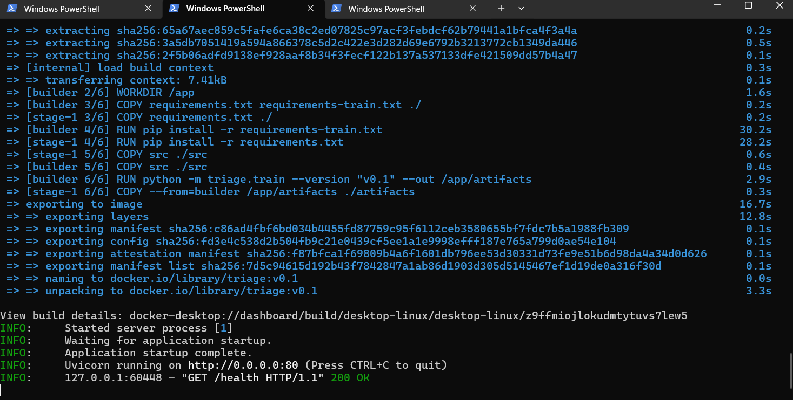
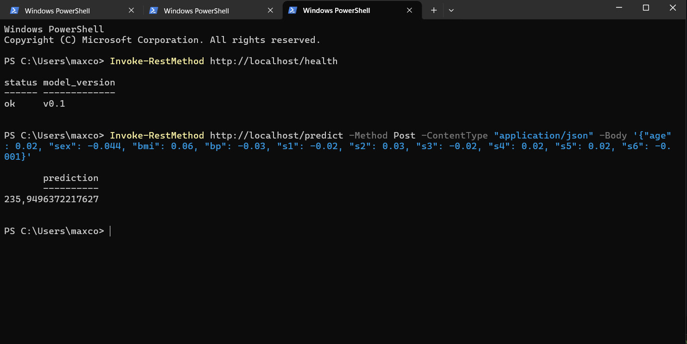
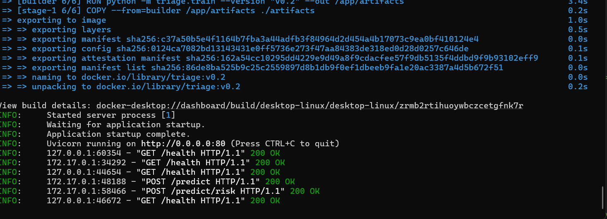
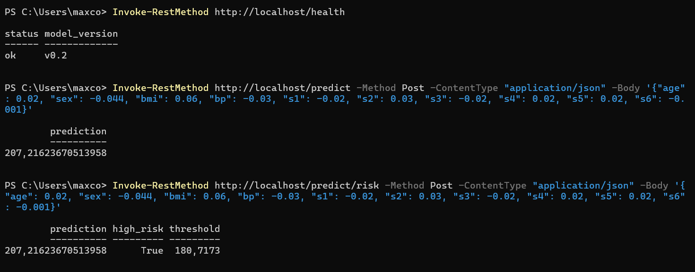

# Diabetes clinic triage

A small API that scores how fast a patient's diabetes is likely to progress, so nurses can call the riskiest patients first. This is Lab 3 of MAIO.

The data is the scikit-learn diabetes dataset (442 patients, 10 features), standing in for real hospital records. The target is a progression index: higher means worse.

There are two releases:

- **v0.1**: `StandardScaler` + `LinearRegression`. The baseline.
- **v0.2**: an average of a Ridge model and a gradient boosting model, plus a "high risk" flag with a calibrated threshold.

The metrics for both are in [CHANGELOG.md](CHANGELOG.md). The improvement is real but small, the changelog explains how small.

## Run it with Docker

The images are public on GHCR and already contain the trained model, so there is nothing else to install.

```bash
docker pull ghcr.io/pokemax28/miao_lab3:v0.1
docker run -it -p 80:80 ghcr.io/pokemax28/miao_lab3:v0.1
```

```bash
docker pull ghcr.io/pokemax28/miao_lab3:v0.2
docker run -it -p 80:80 ghcr.io/pokemax28/miao_lab3:v0.2
```

Both use port 80, so stop one (Ctrl+C) before starting the other. If `docker pull` asks for a login, the package is still private and needs to be set to public in the GitHub package settings.

Once it runs, from another terminal:

```bash
curl http://localhost:80/health
```

```json
{"status": "ok", "model_version": "v0.2"}
```

```bash
curl -X POST http://localhost:80/predict -H "Content-Type: application/json" \
  -d '{"age": 0.02, "sex": -0.044, "bmi": 0.06, "bp": -0.03, "s1": -0.02, "s2": 0.03, "s3": -0.02, "s4": 0.02, "s5": 0.02, "s6": -0.001}'
```

```json
{"prediction": 207.21623670513958}
```

On Windows PowerShell, `curl` is not the real curl. Use this instead:

```powershell
Invoke-RestMethod http://localhost/predict -Method Post -ContentType "application/json" -Body '{"age": 0.02, "sex": -0.044, "bmi": 0.06, "bp": -0.03, "s1": -0.02, "s2": 0.03, "s3": -0.02, "s4": 0.02, "s5": 0.02, "s6": -0.001}'
```

With v0.1 the same payload gives 235.949... and `model_version` is `v0.1`.

## Endpoints

**`GET /health`** returns `{"status": "ok", "model_version": "v0.2"}`.

**`POST /predict`** takes a JSON object with the ten features (`age`, `sex`, `bmi`, `bp`, `s1` to `s6`), all finite numbers, and returns `{"prediction": <float>}`. Extra keys are ignored.

**`POST /predict/risk`** (v0.2 only) takes the same body and also says whether the patient is flagged:

```json
{"prediction": 207.2, "high_risk": true, "threshold": 180.7}
```

`high_risk` is just `prediction >= threshold`. On v0.1 this route answers 404.

### Errors

Bad input gets HTTP 422 and a JSON body. Missing field, wrong type, NaN or infinity, and broken JSON all end up here. For example, leaving out `s6`:

```json
{
  "error": "validation_error",
  "message": "Invalid request payload",
  "details": [
    {"field": "s6", "issue": "Field required", "type": "missing"}
  ]
}
```

`details` has one entry per problem. `field` is the feature name (or `body` if the JSON itself cannot be parsed), `issue` is the message, and `type` is the validation error type (`missing`, `float_parsing`, `finite_number`, `json_invalid`). An unexpected crash returns 500 with `{"error": "internal_error", "message": "..."}`.

## Run it without Docker

You need Python 3.13.

```bash
python -m venv .venv
source .venv/bin/activate
pip install -r requirements-dev.txt

python -m triage.train --version v0.2 --out artifacts
uvicorn triage.app:app --port 8000
```

On Windows PowerShell, activate the environment with `.venv\Scripts\Activate.ps1` instead.

`--version v0.1` trains the baseline instead. Training writes the model and a `metrics.json` into `artifacts/`, and the API reads them from there.

To redo the cross-validation comparison from the changelog:

```bash
python -m triage.evaluate
```

It takes about 40 seconds and writes `metrics/cv_comparison.json`.

Lint and tests, the same as in CI:

```bash
ruff check .
ruff format --check .
pytest
```

To build the image yourself:

```bash
docker build -t triage:v0.2 .
docker run -it -p 80:80 triage:v0.2
bash scripts/smoke_test.sh http://localhost:80 v0.2
```

The smoke test script needs `curl` and `jq`.

## Reproducibility

Seeds are fixed (42, also for the train/test split), every package is pinned in `requirements*.txt`, and the Docker image uses `python:3.13-slim`. The image trains its own model during the build, so it is rebuilt from source every time. Running the same code in the same environment gives the same metrics. Timing numbers (latency, fit time) vary a bit between machines.

## CI and releases

`.github/workflows/ci.yml` runs on every push and pull request: ruff, the tests, a Docker build followed by a smoke test on the running container, a training run for each version, and the cross-validation comparison. The trained models and reports are saved as workflow artifacts. If lint or a test fails, the run fails.

`.github/workflows/release.yml` runs when a tag starting with `v` is pushed. It builds the image, starts the container and runs `scripts/smoke_test.sh` against it, pushes the image to GHCR, and creates a GitHub Release using the matching section of the changelog plus the `metrics.json` taken from the image.

To publish a version:

```bash
git tag v0.2
git push origin v0.2
```

## Screenshots

v0.1 running in Docker, then queried with `/health` and `/predict`:





v0.2 running in Docker, with `/health`, `/predict` and `/predict/risk`:





## Layout

```
src/triage/    features, models, risk flag, train and evaluate scripts, the API
tests/         tests for training, the risk flag and the API
scripts/       smoke test used by the release workflow
metrics/       cross-validation report
docs/          screenshots of both versions running
Dockerfile     two stages: train, then a slim image with the model inside
```
